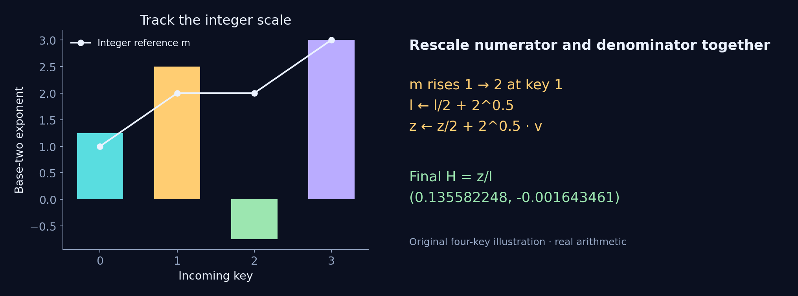

# A softmax state that changes its scale

For head `h`, query row `r` and key row `j`, the mathematical operation is

```text
s[r,j,h] = (Q[r,2h] * K[j,2h] + Q[r,2h+1] * K[j,2h+1]) / sqrt(2)
p[r,j,h] = exp(s[r,j,h]) / sum_k exp(s[r,k,h])
H[r,2h+d] = sum_j p[r,j,h] * V[j,2h+d]       d = 0,1
Y[r,o] = sum_d H[r,d] * W[o,d]               d = 0,1,2,3
```

The implementation uses the specified binary32 value of the square-root
constant, `1.4142135381698608`. Moving `log2(e)/sqrt(2)` into Q lets the
repeated products produce `t = s*log2(e)`. Then `exp(s) = 2^t`.

## One streaming update

Write `t = n + f`, with integer `n = floor(t)` and `0 <= f < 1`. A state
holds integer reference `m`, denominator `l` and two weighted sums `z`.
For each new key, the real-arithmetic recurrence is

```text
m_new = max(m, n)
old_scale = 2^(m - m_new)
new_weight = 2^f * 2^(n - m_new)
l_new = old_scale*l + new_weight
z_new = old_scale*z + new_weight*v
H = z_new / l_new
```

On the first key, seed the state with `m=n`, `l=2^f`, `z=2^f*v`.
Every rescale factor outside the fractional exponent is an integer power
of two, so the circuit implements it with shifts. Both numerator
coordinates and the denominator must change scale together.

## A four-key example

Use base-two scores `[1.25, 2.50, -0.75, 3.00]` and value pairs
`[(0.25,-0.125), (-0.25,0.375), (0.125,0.25), (0.375,-0.25)]`.
These numbers were chosen for this illustration.

| Key | Base-two score | Reference m | Old-state scale | Denominator l | H0 | H1 |
| --- | ---: | ---: | ---: | ---: | ---: | ---: |
| 0 | 1.25 | 1 | 0.0000 | 1.189207 | 0.250000 | -0.125000 |
| 1 | 2.50 | 2 | 0.5000 | 2.008817 | -0.102002 | 0.227002 |
| 2 | -0.75 | 2 | 1.0000 | 2.157468 | -0.086361 | 0.228586 |
| 3 | 3.00 | 3 | 0.5000 | 2.078734 | 0.135582 | -0.001643 |

At key 1, the reference rises from 1 to 2. The old state is halved before
adding the new contribution. At key 2, the reference stays at 2, so the
incoming contribution is shifted instead. Key 3 raises the reference
again. The final normalized vector is approximately
`(0.135582248, -0.001643461)`.



[SVG](figures/online-update.svg) · [PDF](figures/online-update.pdf) ·
[Example values](example.json)

## Merge the last key through a sigmoid

For the first three keys, `mu = m + log2(l) = 3.109339167`. The final key's
fraction of the complete partition is

```text
a = 1 / (1 + 2^(-(3.0 - mu))) = 0.481062030
H_final = (1-a)*H_prefix + a*V_last
```

The direct four-key softmax, the streaming recurrence and this prefix/tail
merge agree within `1e-15` in the checked real-arithmetic illustration.
The RTL approximates the exponential, reciprocal, logarithm, sigmoid and
products. This example explains the identity; it does not establish its
bit-level error over all inputs.
