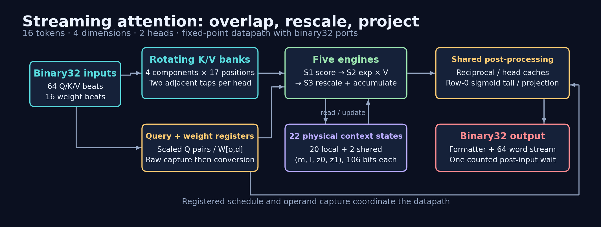

# Compute while the input is arriving

The 64-beat input window is useful compute time. As soon as a query and a
key are available, a static issue table assigns their two-dimensional dot
product to an engine. Later keys keep arriving while earlier contributions
are already inside the softmax recurrence. This overlap is the reason the
measured post-input wait can be one cycle despite a three-stage engine and
additional output arithmetic.



[Editable diagram](figures/architecture.drawio) ·
[SVG](figures/architecture.svg) · [PDF](figures/architecture.pdf)

## Rotating K/V storage

Each of four K components and four V components has a 17-entry register
ring. Every clock rotates every ring by one position. The component number
selects where an arriving word is inserted. Sixteen entries hold the token
data; the extra position provides the schedule's phase offset.

Each head can read two neighboring K positions. Instead of a wide arbitrary
token selector, an engine chooses among four fixed two-component taps.
The matching V is read one ring position later in the next stage, after
the data has rotated. That removes a pair of V pipeline registers from
each engine while preserving the key/value association.

Queries are kept by row, head and component. Each engine's `qbus` contains
its assigned query pairs, including access for the final shared contexts.
Weights are captured raw and converted one cycle later; the write enable
ends after beat 15.

## Five engines, three stages each

| Stage | Work | Registered payload |
| --- | --- | --- |
| S1 | Select Q and a K tap; form the scaled base-two score | Score, head/tap and state tags |
| S2 | Approximate the fractional exponent; multiply by two V coordinates | Integer exponent, weight, weighted values and state tags |
| S3 | Read one context, rescale and accumulate | Updated `m`, `l`, `z0`, `z1` |

Each logical context is one query row and one head: 16 × 2 = 32 contexts.
Each engine has four local physical states; two more states are shared
across the engines. The total is 22 states, each 106 bits. The issue tables
reuse a slot after its previous context is complete. Seed tags replace its
old contents on the new context's first update.

The table also separates dependent updates far enough for the three-stage
recurrence. Context tags travel with the arithmetic. A fast multiplier
alone would not make an invalid dependency schedule correct.

## Online base-two scaling

The query converter absorbs `log2(e) / sqrt(2)`, so a score is already in
base-two exponent units. Split it into integer `n` and fraction `f`.
The state reference `m` tracks the largest integer part, while `2^f`
supplies the mantissa of the new weight. Raising `m` rescales the old
denominator and both weighted sums by right shifts.

The recurrence therefore needs no full score or probability matrix in
storage. Its scale can differ from a softmax normalized by the exact
maximum score: the ratio `z/l` is unchanged in real arithmetic. Truncation
and interpolation do introduce numerical error in the actual circuit.
The [worked update](ALGORITHM.md) shows both the scale change and the ratio.

## Capture the completing state

A final-state selector captures an engine's just-completed update into
`ps`. The reciprocal, log and projection paths read that register instead
of selecting combinationally across all 22 stored states. Shared floating
states use a masked merge of engine updates; the static schedule determines
which writer is active.

The post path normalizes the denominator once per head and reuses its
reciprocal for two weighted sums. Head-zero results alternate between two
caches so the next row can be prepared while four words of the current row
are projected. Multiplier operands and control flags are registered ahead
of use to keep selection logic out of the longest multiply paths.

## The first row's last key

The last key arrives near the first output deadline. Row zero therefore
accumulates a prefix of 15 keys in the ordinary engines, then merges key 15
with a sigmoid identity. For prefix average `H`, prefix partition `Z`,
last score `t` and value `v`, the exact identity is

```text
mu = log2(Z)
a  = 1 / (1 + 2^(-(t - mu)))
H' = H + a * (v - H)
```

The implementation splits the sigmoid into table and correction terms
and shares multipliers with normalization and projection. This tail is an
arithmetic dependency solution, not a cached answer. Its approximations
are described in the [numerical model](NUMERICAL_MODEL.md).

## Four projected words per row

The two normalized head vectors form four coordinates. For output
coordinate `o`, the circuit evaluates `sum(H[d] * W[o][d])`. The weights'
first index is the output coordinate, so the input 4 × 4 weight matrix is
used transposed relative to the concatenated head row.

Partial sums are registered as three terms. The formatter completes their
sum, extracts a fixed-point magnitude and uses an external integer-to-float
converter. Four projected words per row produce 64 consecutive outputs.

See [protocol](PROTOCOL.md) for timing and [evaluation](EVALUATION.md) for
the measured candidate's remaining qualification work.
