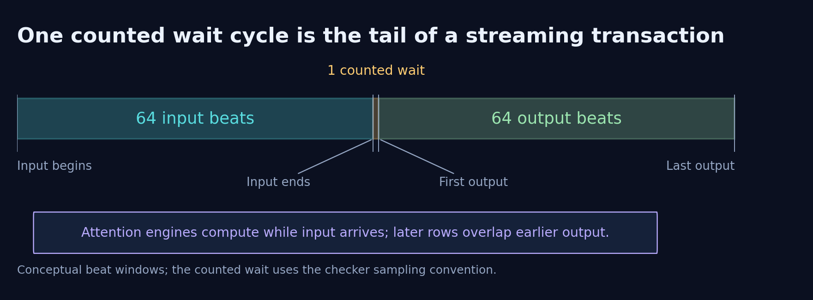

# Interface and transaction timing

The top-level module is `F_ATTN`. Its public parameters retain the default
23 fraction bits, eight exponent bits and the supplied compliance setting.
Changing those parameters does not resize the internal fixed-point design.

| Port | Direction | Meaning |
| --- | --- | --- |
| `clk` | Input | Rising-edge state updates |
| `rst_n` | Input | Asynchronous active-low control/output reset |
| `in_valid` | Input | High for 64 consecutive Q/K/V beats |
| `Q`, `K`, `V` | Input, 32 bits each | Simultaneous row-major 16 × 4 matrices |
| `out_weight` | Input, 32 bits | Row-major 4 × 4 weights during the first 16 beats |
| `out_valid` | Output | High for 64 consecutive output words |
| `out` | Output, 32 bits | Row-major 16 × 4 projected result, binary32 |

Input beat `b` maps to row `b >> 2` and component `b & 3`. Weight beat `b`
maps to `W[b >> 2][b & 3]`; output beat `b` maps to `Y[b >> 2][b & 3]`.
Weights are indexed as `W[output][input]` by the projection.

Inputs change on falling edges and are sampled on rising edges. Q and
weights have raw capture registers followed by conversion; their valid
and index tags are delayed with them. The K/V rings rotate continuously.
Scheduled reads only use data belonging to the current transaction.

[SVG](figures/transaction.svg) · [PDF](figures/transaction.pdf)

Reset clears valid/control state and the registered output terms without
requiring a clock edge. Large datapath banks are seeded or overwritten
before their values are consumed. `out` is positive zero while invalid.
There is no input/output-valid overlap in the checked protocol.

The transaction includes 64 input beats, one counted post-input wait and
64 output beats. The figure separates these windows conceptually; it is
not a gate-level waveform or an exact subcycle timestamp diagram. Repeated
transactions must respect the protocol's inter-transaction gap. The
interface has no independent ready/backpressure signal.
