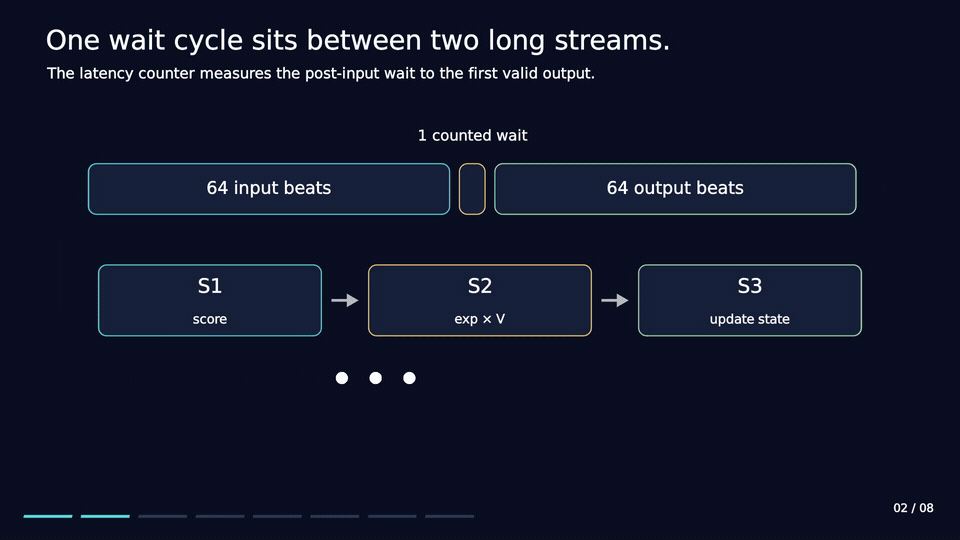

# FlashAttention architecture film

[Watch the full film](attention-architecture.mp4) · [Poster](attention-poster.png) ·
[Online update example](attention-update.gif)

Animation made with [ManimGL](https://github.com/3b1b/manim).

The film is 90.9 seconds, 1920 × 1080 at 30 fps, with English
on-screen explanations and no audio. Both looping previews are 16 seconds.

| Chapter | Topic |
| --- | --- |
| 0:00 | Selected streaming architecture |
| 0:08 | Input window, counted wait and output window |
| 0:18 | Seventeen-position rings and adjacent taps |
| 0:29 | Five engines and twenty-two physical states |
| 0:41 | Original four-key online scaling example |
| 1:00 | First-row sigmoid tail merge |
| 1:12 | Output-weight transpose and shared projection |
| 1:22 | Candidate measurement and qualification scope |

The scenes explain the selected circuit's storage, stages and arithmetic
dependencies. They are conceptual views, not cycle-accurate RTL or gate
waveforms. Context tags in the pipeline scene illustrate interleaving;
they do not reproduce the exact issue table. The four-key numerical
example was constructed for the explanation and checked independently
using real arithmetic.

The measurement scene presents the 12.5 ns candidate and its finite
1,000-frame functional check. Strict SDF timing qualification remains
open. The one-cycle figure is the counted post-input wait, not the complete
transaction duration.

See [Architecture](../docs/ARCHITECTURE.md), [Algorithm](../docs/ALGORITHM.md),
[Evaluation](../docs/EVALUATION.md) and [Results](../results/README.md).
