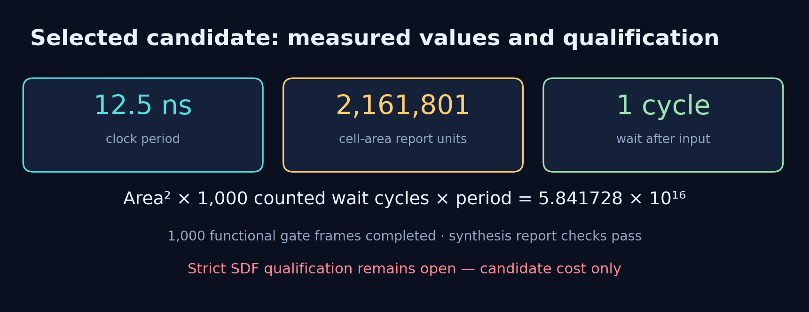

# Candidate performance

| Quantity | Selected candidate |
| --- | ---: |
| Clock period | 12.5 ns |
| Cell area, report units | 2,161,800.783689 |
| Checked frames | 1,000 |
| Wait per frame | 1 cycle |
| Total counted wait | 1,000 cycles |
| Total counted wait × period | 12,500 ns |
| Area² × total wait × period | 5.841728285447968 × 10¹⁶ |
| Approximate snapshot comparison | Rank 1 / 120 (conditional) |
| Strict SDF qualification | Open |

```text
2161800.783689² × 1000 × 12.5 = 58417282854479682.10560901250
```

Lower product is better under the same latency convention and verification
requirements. Area is quoted in the synthesis report's units; no physical
unit conversion is assumed. The source and finite functional checks are
described in [evaluation](../docs/EVALUATION.md).



[SVG](figures/objective.svg) · [PDF](figures/objective.pdf) ·
[Performance data](performance.csv) · [Machine-readable benchmark](benchmark.json)

## Snapshot comparison

The [Lab04 ranking sheet](https://docs.google.com/spreadsheets/d/16rjaQ8dw61-fahOhnfgNhu66pdOijwfEi53SUIfHgw4/edit?gid=539933943#gid=539933943)
was read on 18 October 2026 at 02:51 Asia/Taipei. Its Lab04 tab contains
119 results with positive numeric period, total latency and area, and all
three evaluation stages marked as passing. One populated row without a
complete numeric result is excluded.

Recomputing `area² × total latency × period` from the displayed component
values reproduces all 119 reported rank positions. Using the component
values also avoids sorting by the rounded Performance column.

The selected candidate has no smaller reference cost and no exact tie.
Inserting it adds one comparison entry: Rank 1 / 120. This is the
candidate's conditional arithmetic position in this fixed snapshot, not
an official course-assigned rank. The candidate's strict SDF qualification
remains open; the comparison does not change that status.

The product is conditional on unresolved SDF qualification. It is not an
accepted score or an official course-assigned rank. A shorter period may require
more cell area, and the area term is squared, so the tightest requested
clock need not give the smallest product.
