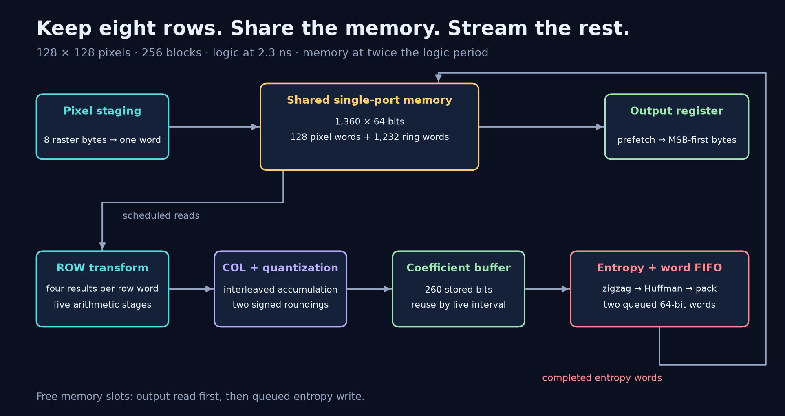

# Lab05 — JPEG-like Encoder (JPEGLENC)

A streaming encoder for 128 × 128 grayscale images. A shared single-port
memory holds eight input rows and a ring of compressed words. Pipelined
integer DCT arithmetic, a compact coefficient buffer and a five-stage
entropy coder keep the datapath moving while pixels arrive.

Selected result: 2.3 ns · 833,817 cell-area report units · 370,662 counted cycles
across 100 images.

Approximate snapshot comparison: Rank 1 / 118.

The README has finally decompressed.

[Watch the architecture film](media/jpeg-architecture.mp4) ·
[Read the architecture](docs/ARCHITECTURE.md) ·
[Follow the arithmetic](docs/ALGORITHM.md)

## Performance snapshot

| Metric | Selected result |
| --- | ---: |
| Clock period | 2.3 ns |
| Cell area, report units | 833,817.074646 |
| Checked images | 100 |
| Total counted latency | 370,662 cycles |
| Counted latency × period | 852,522.6 ns |
| Area² × total latency × period | 5.927171 × 10¹⁷ |
| RTL and matching SDF gate checks | 100 / 100 images |
| Synthesis timing | Met |
| Approximate snapshot comparison | Rank 1 / 118 |

Counted latency starts at the end of the 16,384-cycle input burst and runs
through the last output byte, including output bubbles. The transform
already runs during input. This figure excludes input reception and is
not the complete image transaction time.

The selected source passed native synthesis timing and matching SDF gate
simulation on the supplied 100-image corpus. The comparison inserts it
into 117 positive, passing results in the 25 October 2026 snapshot.
It is a comparison rank, not an official course-assigned rank.
See [evaluation](docs/EVALUATION.md) and [results](results/README.md).

## Architecture walkthrough

1. Pack incoming raster pixels into 64-bit words and reuse an eight-row
   line buffer with a block-row-dependent address rotation.
2. Reserve memory slots for pixel writes and DCT reads. Free slots serve
   output prefetches or completed entropy words.
3. Compute the row and column integer transforms with fixed-coefficient
   arithmetic, preserving both required signed rounding steps.
4. Reuse coefficient registers according to their live intervals, then
   scan in zigzag order and form Huffman fields.
5. Pack the fields into 64-bit words, queue them in the shared memory,
   and emit their bytes after input ends.

| Read next | Contents |
| --- | --- |
| [Selected RTL](rtl/JPEGLENC.v) | Six-module Verilog implementation |
| [Annotated RTL](rtl/annotated/README.md) | Comment-only reading copy |
| [Architecture](docs/ARCHITECTURE.md) | Memory sharing, pipelines and lifetime reuse |
| [Arithmetic and coding](docs/ALGORITHM.md) | Exact rounding, zigzag and entropy packing |
| [Interface and timing](docs/PROTOCOL.md) | Ports, reset, memory phase and latency |
| [Evaluation](docs/EVALUATION.md) | Selected source, finite checks and dependencies |
| [Results](results/README.md) | Aggregate measurement and comparison method |
| [Architecture film](media/README.md) | Walkthrough, short loops and chapter list |

[Back to the course index](../README.md)
