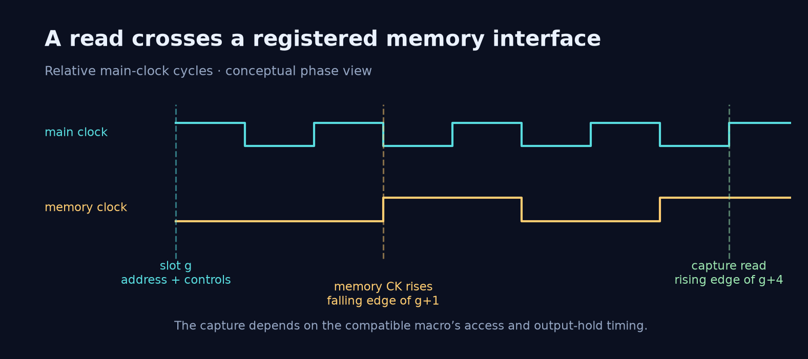

# Interface and timing

| Port | Direction | Meaning |
| --- | --- | --- |
| `clk` | Input | Main logic clock |
| `rst_n` | Input | Active-low reset for control and visible outputs |
| `in_valid` | Input | One complete raster input burst |
| `in_data[7:0]` | Input | Unsigned grayscale pixel |
| `out_valid` | Output | Current encoded byte is valid |
| `out_data[7:0]` | Output | Raw entropy byte; zero while invalid |

An image supplies 16,384 consecutive input beats in raster order.
The encoder has no input-ready port, and its schedule assumes that
uninterrupted burst. Images are processed one at a time. The next
transaction starts after the preceding output has finished.

`out_valid` must not overlap `in_valid`. Output bubbles are allowed.
Each asserted output cycle carries one byte, most significant byte
first within each packed word. The final partial byte is padded with
ones, and the final-word byte count limits transmission to the encoded
stream length.

## What latency counts

The measured interval starts at the falling edge where the final input
cycle ends and continues through the last output cycle. Output cycles
and bubbles count; the 16,384 input cycles do not. For 100 images the
selected implementation accumulates 370,662 counted cycles. Multiplying
by 2.3 ns gives 852,522.6 ns for that counted interval.

Work during input explains why the counted interval can be short.
It must not be interpreted as the complete transform time from the
first input pixel.

## Memory clock and capture

The macro is clocked by a falling-edge toggle, with a 4.6 ns period at
the selected 2.3 ns logic clock. For an access slot `g`, address and
controls launch at its main rising edge, the macro clock rises at the
falling edge in cycle `g+1`, and the requested read is captured at the
main rising edge of `g+4`.

This capture schedule depends on the macro's access and output-hold
behavior across adjacent accesses. A slower logic clock or a zero-delay
memory replacement is not automatically an equivalent simulation setup.
Use a compatible memory timing model and qualify the combined design.

Reset clears valid bits, queues, counters and visible outputs. Many
arithmetic data registers have no reset and are protected by their
valid tags. The memory toggle settles low on idle falling edges; the
clock must run through the idle/reset interval before the first image.
