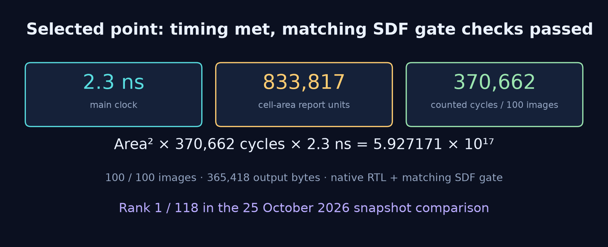

# Performance

| Quantity | Selected result |
| --- | ---: |
| Clock period | 2.3 ns |
| Cell area, report units | 833,817.074646 |
| Checked images | 100 |
| Total counted latency | 370,662 cycles |
| Counted latency × period | 852,522.6 ns |
| Area² × total latency × period | 5.927171168311149 × 10¹⁷ |
| RTL / matching SDF gate checks | Passed, 100 / 100 |
| Synthesis timing | Met |
| Approximate snapshot comparison | Rank 1 / 118 |

```text
833817.074646² × 370662 × 2.3 = 592717116831114947.8784560621416
```

Lower product is better under the same latency convention and
qualification requirements. Area includes the external memory macro
and is quoted in the synthesis report's units.



[SVG](figures/objective.svg) · [PDF](figures/objective.pdf) ·
[Performance data](performance.csv) · [Machine-readable benchmark](benchmark.json)

## Snapshot comparison

The [Lab05 ranking sheet](https://docs.google.com/spreadsheets/d/16rjaQ8dw61-fahOhnfgNhu66pdOijwfEi53SUIfHgw4/edit?gid=25877961)
was read on 25 October 2026 at 03:52 Asia/Taipei. Its Lab05 tab has
117 entries with positive numeric period, total latency and area,
and all three evaluation stages marked as passing. These comprise
101 first-demo entries and 16 second-demo entries.

Recomputing `area² × total latency × period` from the component values
gives no reference entry below the selected result and no exact tie.
Inserting it into all 117 positive passing results gives Rank 1 / 118.
Using the 101 first-demo entries alone gives Rank 1 / 102. The combined
comparison does not merge the course's two separate demo rank columns
or its score adjustments.

This is an anonymous insertion comparison against a fixed snapshot,
not an official course-assigned rank. It does not predict a future
leaderboard or establish a global optimum.
